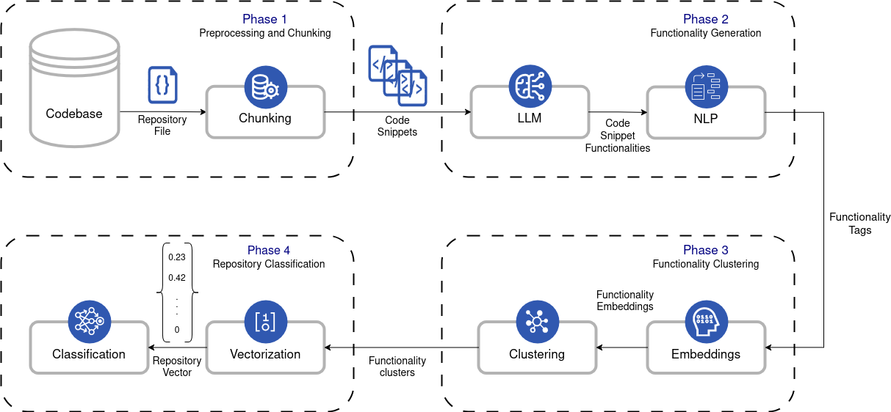

# Pipeline

This document describes the end-to-end SAST-LLM thesis pipeline and links each stage to its detailed reference file.

For an exact command-by-command execution checklist, see [09_FULL_PIPELINE_RUNBOOK.md](./09_FULL_PIPELINE_RUNBOOK.md).

## Overview

SAST-LLM transforms raw source repositories into semantic functionality representations and classifies repositories from their behavioral cluster profile.

```text
Code repositories
  -> data ingestion and chunking
  -> snippet functionality generation
  -> functionality embedding and dataset split metadata
  -> functionality clustering
  -> repository vectorization
  -> repository classification
```

## Pipeline diagram



## Stage map

| Stage                          | Main command                     | Main output                                             | Detailed reference                                                       |
| ------------------------------ | -------------------------------- | ------------------------------------------------------- | ------------------------------------------------------------------------ |
| 1. Data ingestion and chunking | `argus load`                     | `repositories`, `files`, `snippets`                     | [01_DATA_INGESTION_AND_CHUNKING.md](./01_DATA_INGESTION_AND_CHUNKING.md) |
| 2. Functionality generation    | `argus generate_functionalities` | `functionalities.description`, `functionalities.tag`    | [02_FUNCTIONALITY_GENERATION.md](./02_FUNCTIONALITY_GENERATION.md)       |
| 3. Embedding and splitting     | `argus embed`, `argus split`     | Qdrant vectors and split payloads, `repositories.split` | [03_EMBEDDING_AND_SPLITTING.md](./03_EMBEDDING_AND_SPLITTING.md)         |
| 4. Functionality clustering    | `argus cluster --mode ... --config-path configs/clustering.yaml`       | `functionalities.cluster_id`, clustering model          | [04_FUNCTIONALITY_CLUSTERING.md](./04_FUNCTIONALITY_CLUSTERING.md)       |
| 5. Repository classification   | `argus classify --mode ... --config-path ...` | model artifacts, predictions, metrics                   | [05_REPOSITORY_CLASSIFICATION.md](./05_REPOSITORY_CLASSIFICATION.md)     |

For debugging and validation, `argus-inspect-distribution` and `argus-inspect-timeseries` inspect one repository and print how its clustered functionalities are encoded before model training.

Storage and configuration references:

- [06_STORAGE_AND_DATA_ACCESS.md](./06_STORAGE_AND_DATA_ACCESS.md)
- [07_CONFIGURATION_REFERENCE.md](./07_CONFIGURATION_REFERENCE.md)
- [08_CLUSTERING_RESEARCH_GUIDE.md](./08_CLUSTERING_RESEARCH_GUIDE.md) for selecting and validating K in an experiment

## End-to-end data flow

```text
Dataset directory
  -> CodeProcessor
  -> PostgreSQL repositories/files/snippets
  -> SnippetProcessor or cached functionality loader
  -> PostgreSQL functionalities
  -> SentenceTransformer embeddings
  -> Qdrant vectors
  -> train/test split payloads
  -> MiniBatchKMeans cluster ids
  -> repository cluster-count vectors
  -> Lightning binary classifier
  -> prediction and metric JSON files
```

## Practical execution order

A full experiment from raw local dataset usually follows:

```bash
argus load
argus generate_functionalities
argus embed
argus split
argus cluster --mode train --config-path configs/clustering.yaml
argus classify --mode train --config-path configs/classification.mlp.yaml
argus cluster --mode test --config-path configs/clustering.yaml
argus classify --mode test --config-path configs/classification.mlp.yaml
```

The compact wrappers run only the final model stages:

```bash
argus train --config-path configs/classification.mlp.yaml --clustering-config-path configs/clustering.yaml
argus test --config-path configs/classification.mlp.yaml --clustering-config-path configs/clustering.yaml
```

Current wrapper behavior:

```text
train -> cluster --mode train -> classify --mode train
test  -> cluster --mode test  -> classify --mode test
```

They do not run dataset loading, LLM generation, splitting, or embedding creation.

## Current implementation caveats

- `argus embed` creates missing functionality vectors; `argus split` only assigns PostgreSQL and Qdrant split metadata.
- Classification filters repositories with `processed=true`, so trigger propagation from snippets to files to repositories matters.
- Classification treats every label other than exact `benign` as `malicious`.
- The classification config accepts `l1_param` as an alias for the runtime `l1_lambda` field.
- Repository classification assumes repository ids behave like dense, 1-based indices when building data module indices.

## Thesis interpretation

The classifier does not operate directly on raw source code. Instead, the project builds a semantic abstraction:

```text
source code -> snippets -> functionality tags -> clusters -> repository vector
```

This makes the decision surface easier to inspect because each repository prediction is based on the distribution of clustered functionality descriptions.
